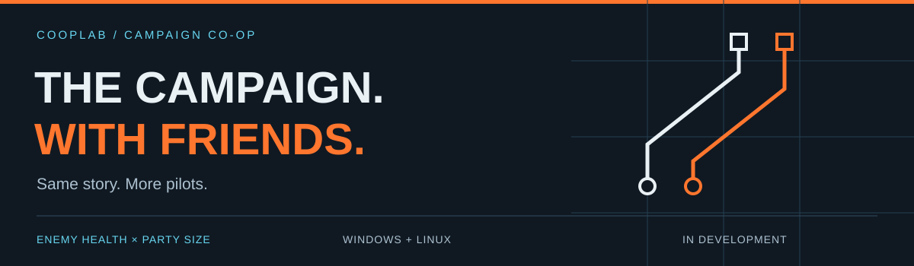
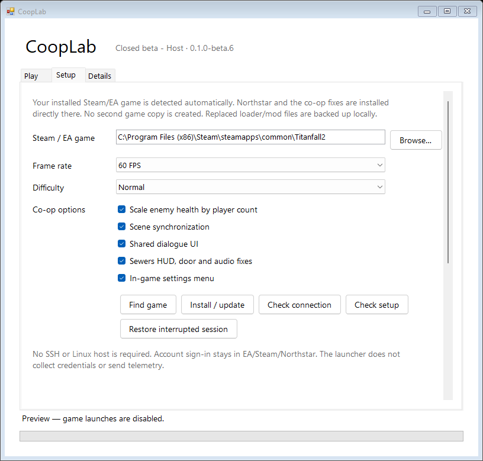
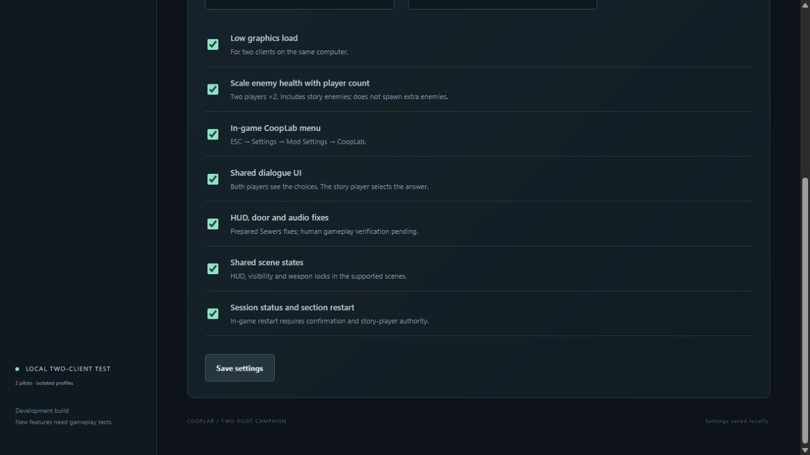

# CoopLab

Same story. More pilots.

An experimental multiplayer campaign project for Titanfall 2, built on Northstar.Coop.
CoopLab brings together shared story scenes, dialogue, tougher co-op fights and native
Windows/Linux launchers that prepare your existing Steam/EA installation.

**[Visit the website](https://cooplab.sigmas.club/) · [Roadmap](ROADMAP.md) · [Development notes](UPDATES.md)**

**In development. Closed testing only. No public download yet.**

## Bring backup. Keep the fight.

Enemy health scales linearly with the number of players: **two players ×2 health,
three ×3, four ×4**. Eligible enemy Titans and damageable story enemies are included.
Enemy counts and damage stay unchanged.

Scaling is optional. Training targets, allies and protected scene actors keep their
original health. Existing enemies are not healed or rescaled when someone joins or
leaves. Larger party sizes still need verification; current closed tests focus on
two players.

## Share the campaign

- **Stay in the story.** Shared scene state, visibility and HUD work while one
  story player drives campaign progression.
- **Share the conversation.** Dialogue UI is shown to the party; the story player
  selects the response.
- **Prepare your existing game.** Native Windows and Linux launchers install the
  matching Northstar and co-op files without making another full game copy.

CoopLab has been taking shape through successive builds, hands-on playtests and
fixes driven by player feedback. Scene, dialogue and combat fixes have been tried
with real players. A complete campaign playthrough, later missions, reconnects and
mixed Windows/Linux sessions still need more testing.

## Development captures

Native launcher preview

Development UI from the closed test build. This is a screenshot, not a download.

Earlier settings interface

A real capture from an earlier interface iteration, showing co-op settings and
enemy health scaling.

## Follow the work

Watch this repository for updates. Questions, ideas and documentation corrections
are welcome through [Issues](https://github.com/Lutzemon/cooplab/issues/new/choose).
See [CONTRIBUTING.md](CONTRIBUTING.md) for feedback guidance.

This repository contains the public website, project information and development
captures. The playable mod, its implementation and closed-test downloads remain
private. A public test is planned, but there is no sign-up or confirmed release date.
Public hosting arrangements will be announced alongside a future test.

Development is AI-assisted, with substantial human direction, debugging and
hands-on playtesting. Optional donations may be introduced to support development
and future relay costs. They would not grant test access or a promised release.

## Credits

Built on [Northstar.Coop](https://github.com/ASpoonPlaysGames/NorthstarMods/tree/cea711a3ce2ebed50d4bcaeb608155c2b6d98beb)
and [Northstar](https://github.com/R2Northstar).

Independent fan project; not affiliated with Respawn or EA. Titanfall 2 belongs to
its respective owners. No game assets, accounts or server access are distributed here.
